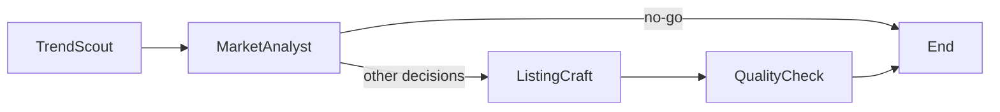

# BorderPilot

A four-stage commerce workflow built with Python and LangGraph. Explore candidate discovery, market analysis, listing drafts, and rule-based quality checks without an API key.

**项目状态：工作流演示原型。** 默认演示应显式使用 `BORDER_PILOT_LLM=mock`。Mock 输出是示例数据，不是真实市场调研、翻译质量或合规结论。

[Architecture](docs/architecture.md) · [CLI source](src/border_pilot/cli.py) · [Tests](tests/test_smoke.py)

## Workflow / 工作流



- **TrendScout:** surfaces candidates from the demo catalogue and provider output.
- **MarketAnalyst:** produces an analysis state; `no-go` ends the graph early.
- **ListingCraft:** builds drafts for the selected marketplace variants.
- **QualityCheck:** checks title length, bullet count, and banned terms, with an LLM review hook.

目前 `watch` 会继续进入 Listing 生成，而不是结束流程。规则检查不能替代平台审核或法律审查。

## Run the mock workflow

Use Python 3.10 or later for this setup; the current CLI uses modern union annotations.

```bash
git clone https://github.com/hhdhh/border-pilot.git
cd border-pilot
python3 -m venv .venv
source .venv/bin/activate
python -m pip install -r requirements.txt
export BORDER_PILOT_LLM=mock
PYTHONPATH=src python -m border_pilot.cli demo
```

Choose marketplaces and request JSON output:

```bash
PYTHONPATH=src python -m border_pilot.cli run   --query "wireless earbuds"   --markets amazon_us,amazon_de   --json
```

To launch the local Gradio interface:

```bash
python app.py
```

No hosted demo is claimed here. See [deployment notes](deploy/huggingface/README.md) before deploying your own instance.

## Model providers

| Configuration | Behavior |
| --- | --- |
| `BORDER_PILOT_LLM=mock` | Uses canned model responses; no model credentials needed |
| `BORDER_PILOT_LLM=anthropic` | Requires `ANTHROPIC_API_KEY` and an available configured model |
| `BORDER_PILOT_LLM=huggingface` | Requires the relevant Hugging Face access and model availability |

Without an explicit provider, existing provider credentials can change the selected backend. Set mock mode explicitly for tests and offline demonstrations. Never commit credentials.

## Tests

```bash
BORDER_PILOT_LLM=mock PYTHONPATH=src python -m pytest -q
```

The suite exercises graph construction, the mock workflow, compliance rules, and CLI output. Passing it does not validate real provider connectivity or business accuracy.

## Known limitations

- Mock content includes canned market figures and illustrative language variants; do not publish them as researched facts.
- A completed graph can contain fallback analysis. Inspect `market_analysis.rationale`, not only the final step.
- Provider defaults and model IDs require checking before a live deployment.
- The repository does not include a GitHub Actions workflow at this revision.

## Code map

`orchestrator.py` wires the graph; `state.py` defines shared state; `agents/` implements the stages; `tools/` contains catalogue and model helpers. These modules live under `src/border_pilot/`.

## License

[MIT](LICENSE).
